**[Official VERIQTA website — veriqta.com](https://veriqta.com/)**

**[Buy books — www.veriqtapress.com](https://www.veriqtapress.com/)**

<table width="100%">
<tr>
<td align="center" valign="top" width="33%"><a href="01-CYBERSECURITY-FOUNDATIONS/THE%20CYBERSECURITY%20HOME%20LAB%20HANDBOOK.pdf">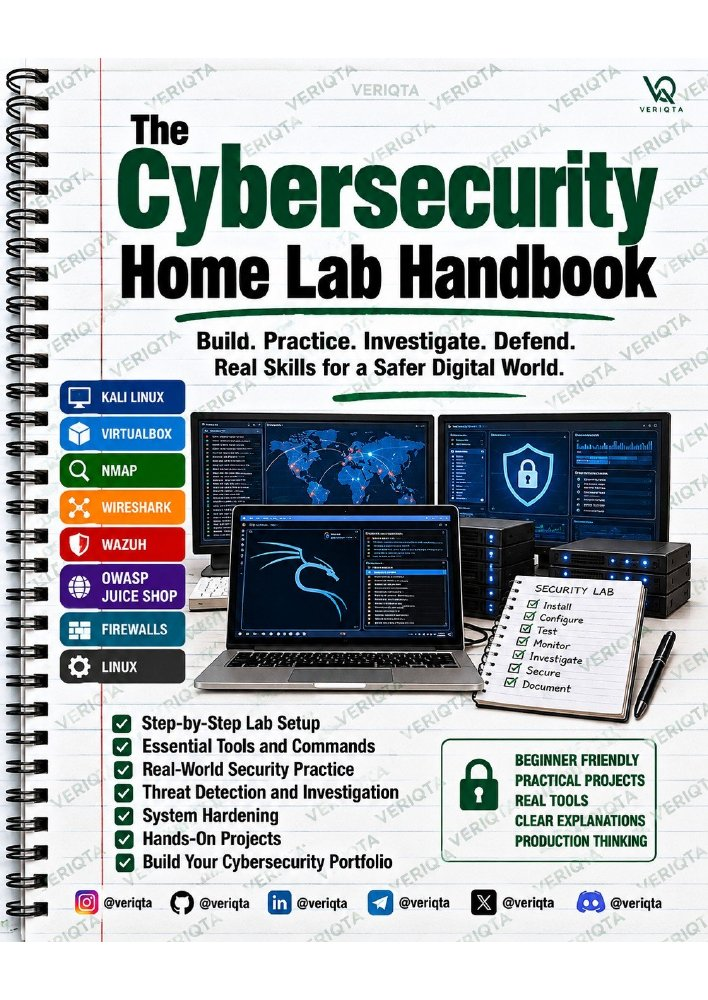</a></td>
<td align="center" valign="top" width="33%"><a href="03-INCIDENT-RESPONSE-AND-DFIR/INCIDENT%20RESPONSE%20AND%20DFIR.pdf">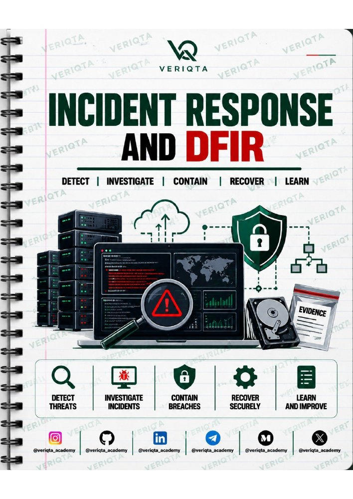</a></td>
<td align="center" valign="top" width="33%"><a href="04-SECURITY-OPERATIONS-CENTER/SIEM%20FROM%20ZERO.pdf">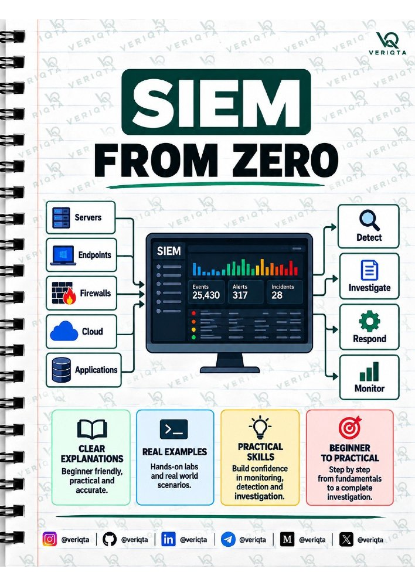</a></td>
</tr>
<tr>
<td align="center" valign="top" width="33%"><a href="10-SPECIALIZED-DEFENSIVE-SECURITY-AND-CAREER/AI%20GOVERNANCE%20ANALYST%20HANDBOOK.pdf">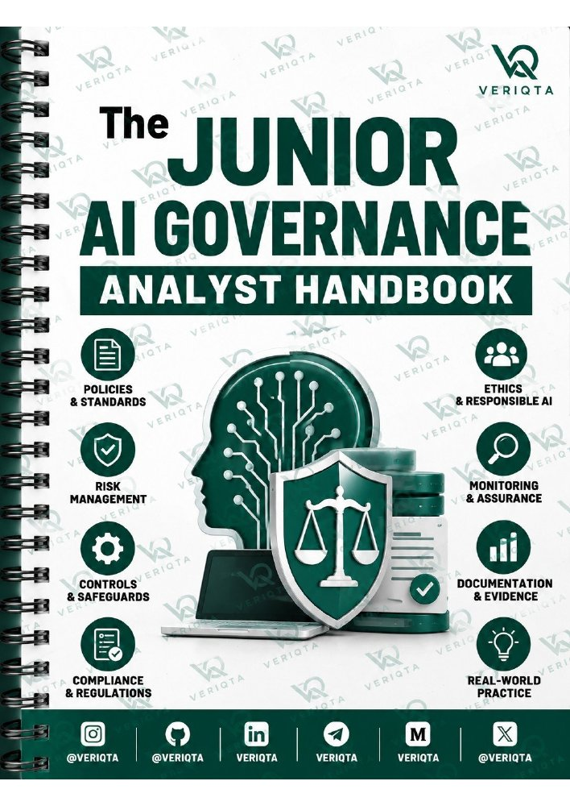</a></td>
<td align="center" valign="top" width="33%">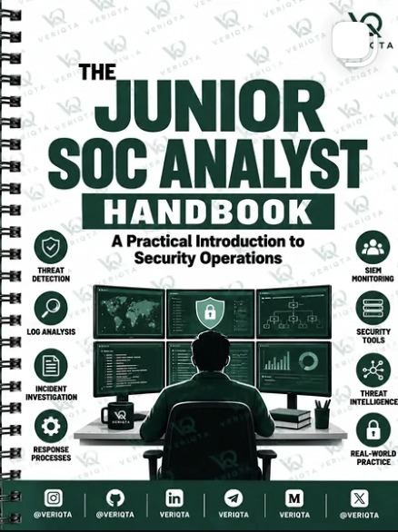 <strong>PDF not available</strong></td>
<td align="center" valign="top" width="33%"><a href="07-GOVERNANCE-RISK-AND-COMPLIANCE/THE%20JUNIOR%20GRC%20ANALYST%20HANDBOOK.pdf">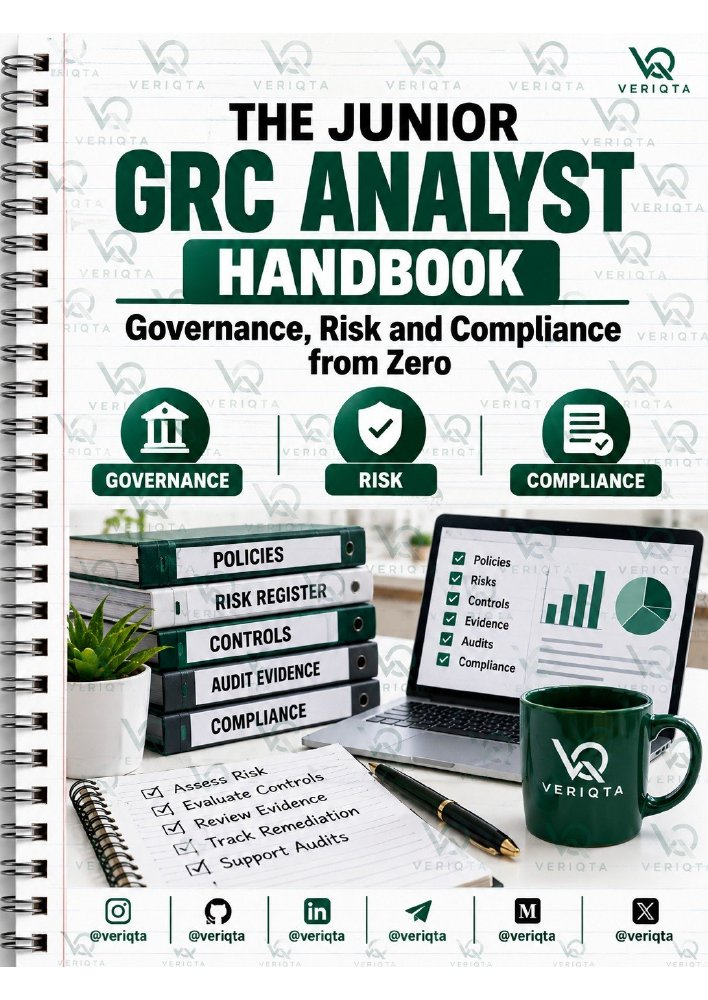</a></td>
</tr>
<tr>
<td align="center" valign="top" width="33%"><a href="02-DIGITAL-FORENSICS/DIGITAL%20FORENSICS%20FROM%20ZERO.pdf">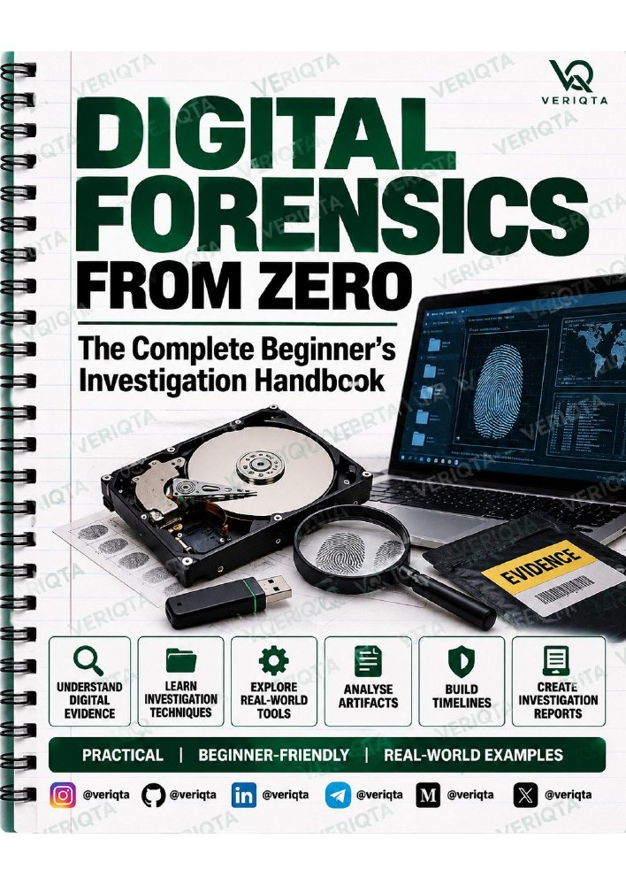</a></td>
<td align="center" valign="top" width="33%"><a href="01-CYBERSECURITY-FOUNDATIONS/THE%20JUNIOR%20CYBERSECURITY%20HANDBOOK.pdf">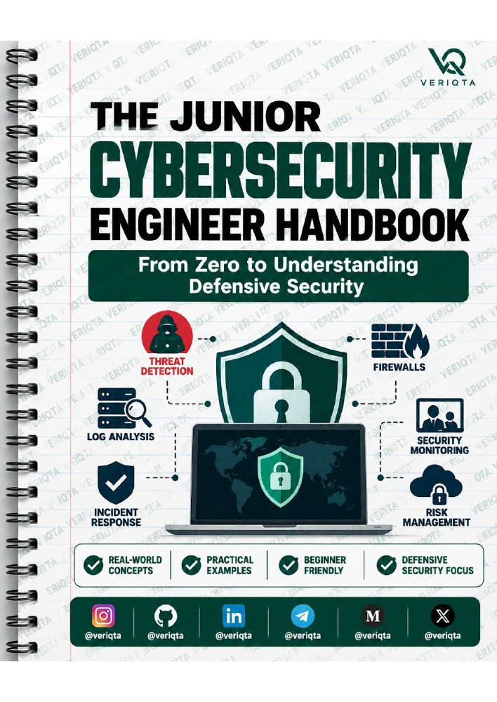</a></td>
<td></td>
</tr>
<tr>
<td align="center" valign="top" width="33%">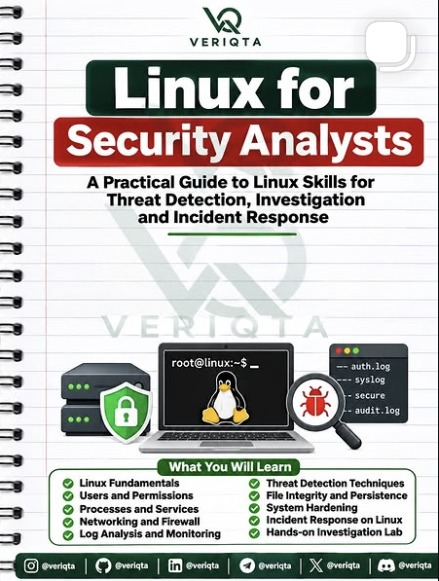 <strong>PDF not available</strong></td>
<td align="center" valign="top" width="33%">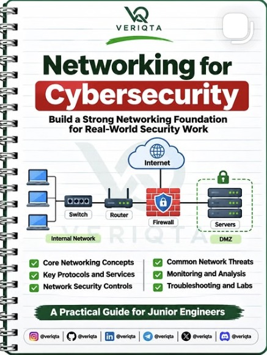 <strong>PDF not available</strong></td>
<td align="center" valign="top" width="33%"><a href="01-CYBERSECURITY-FOUNDATIONS/The%20Junior%20Cybersecurity%20Interview%20Bible.pdf">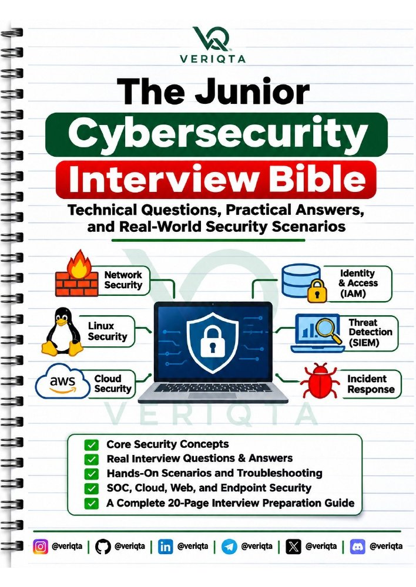</a></td>
</tr>
<tr>
<td align="center" valign="top" width="33%"><a href="05-THREAT-INTELLIGENCE/MITRE%20ATT%26CK%20FOR%20BEGINNERS.pdf">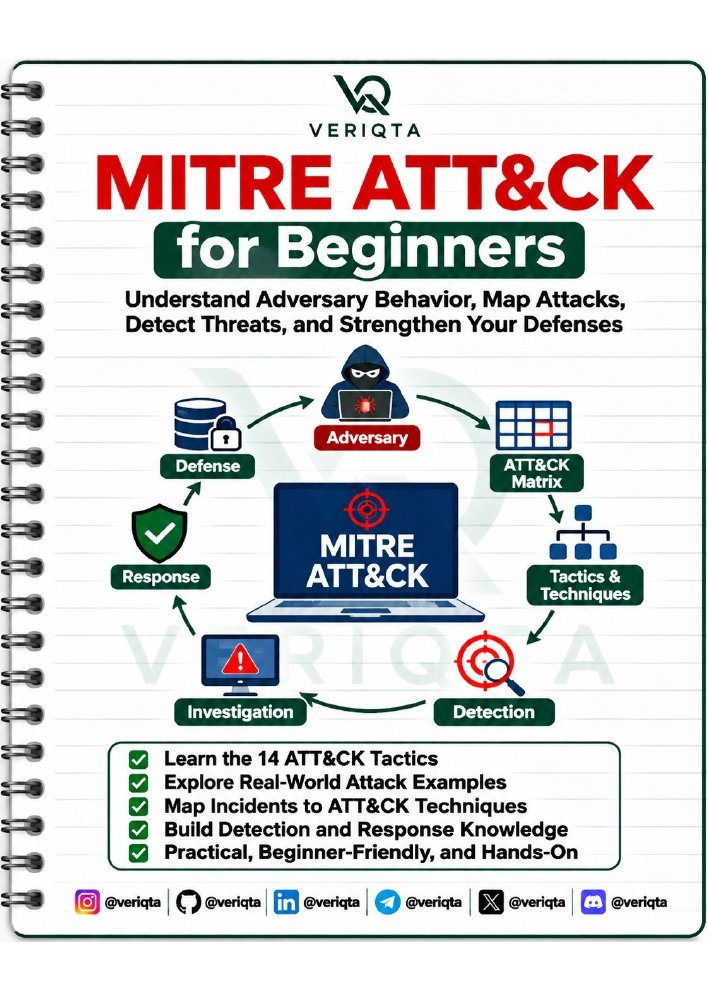</a></td>
<td align="center" valign="top" width="33%"><a href="05-THREAT-INTELLIGENCE/Cyber%20Threat%20Intelligence%20from%20Zero.pdf">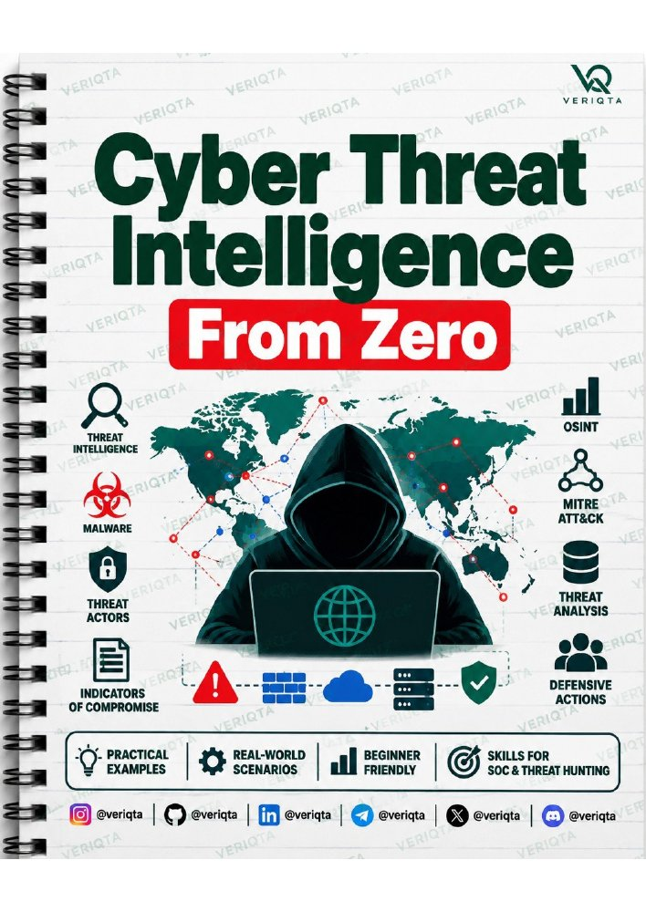</a></td>
<td align="center" valign="top" width="33%"><a href="09-CLOUD-AND-INFRASTRUCTURE-SECURITY/Cloud%20Security%20from%20zero.pdf">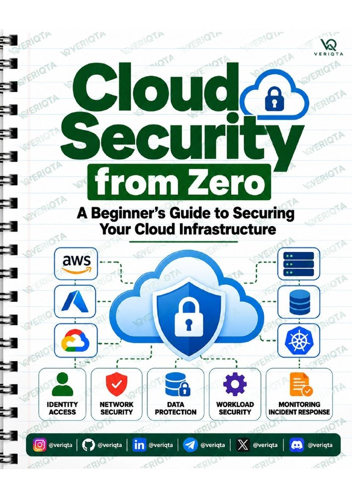</a></td>
</tr>
</table>

[Licence — all rights reserved](LICENSE)
